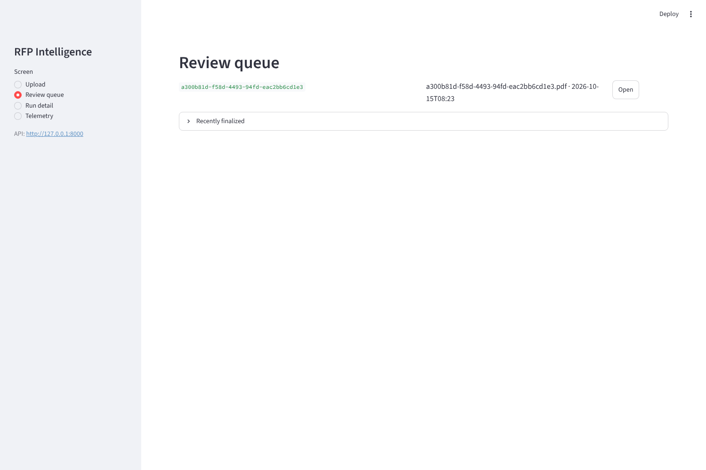
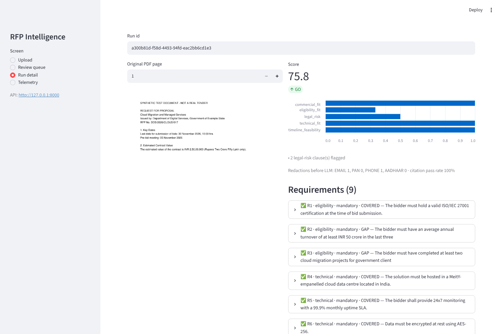
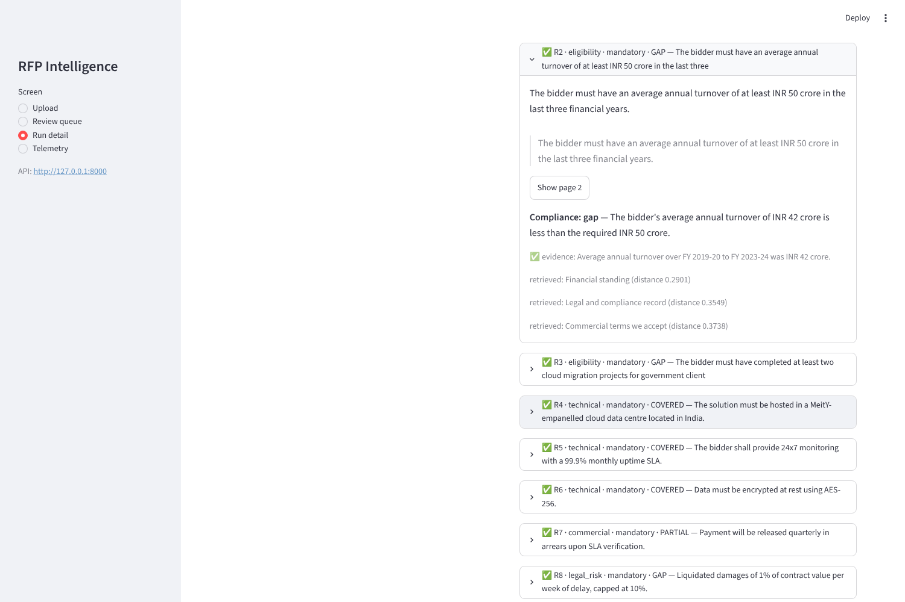
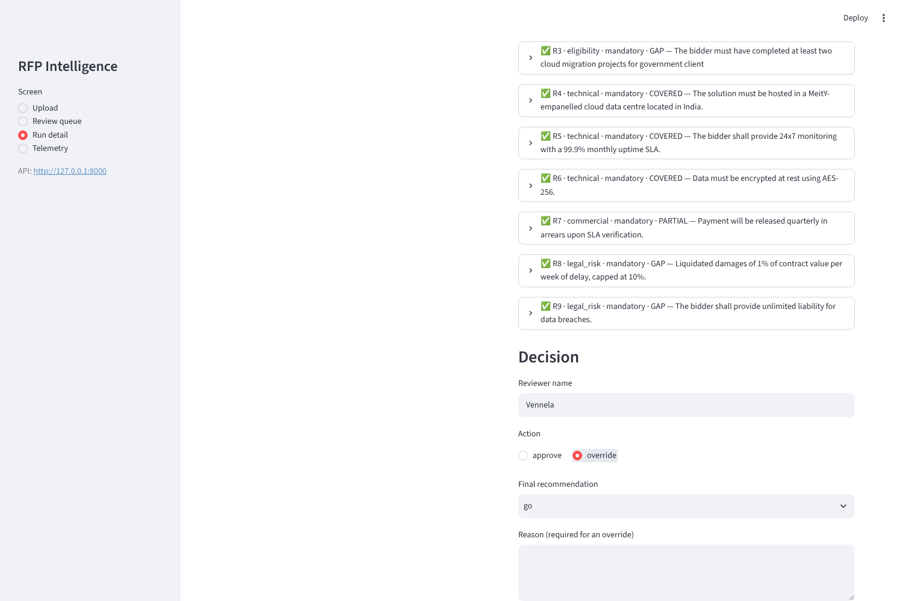
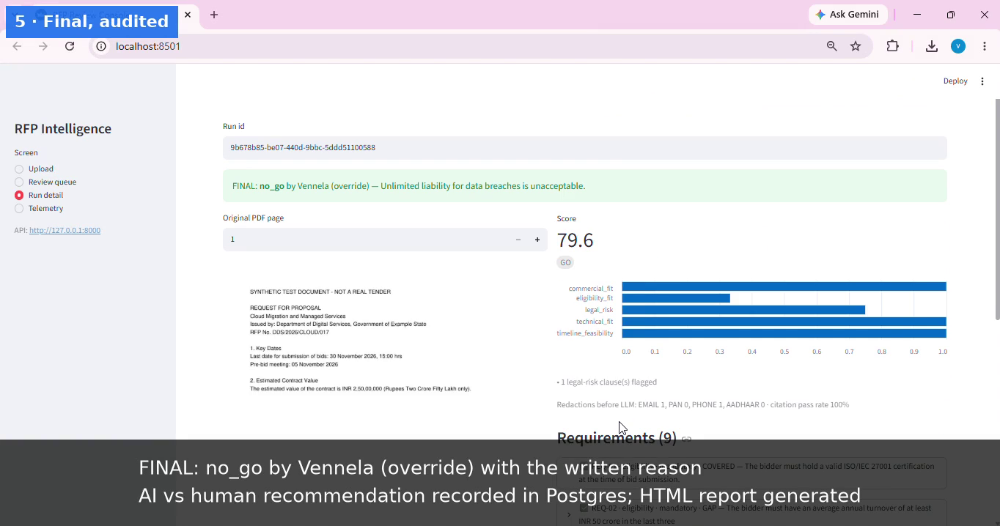
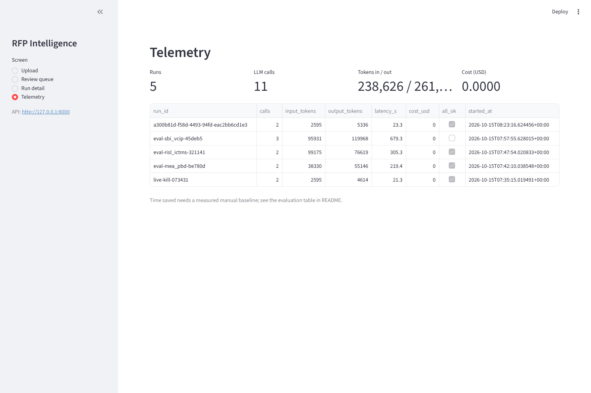
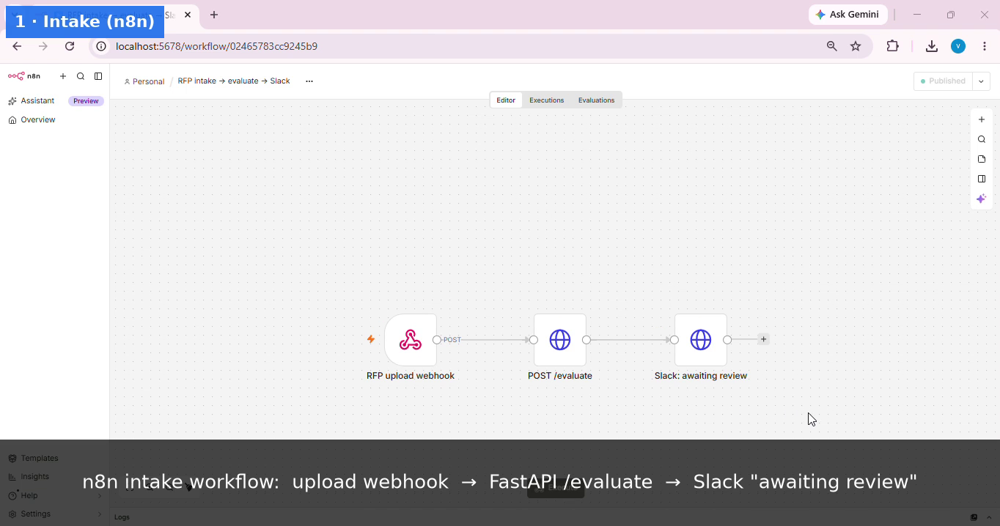
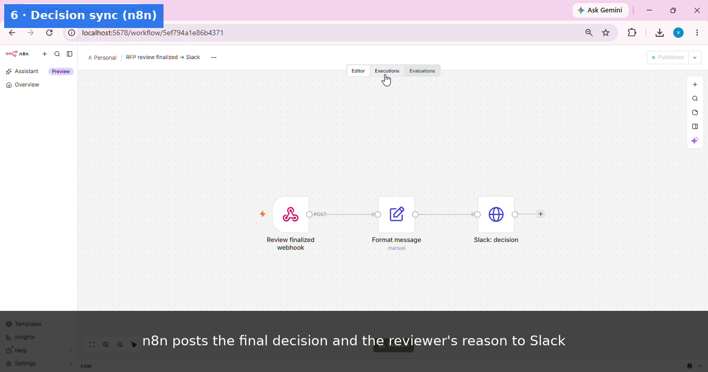
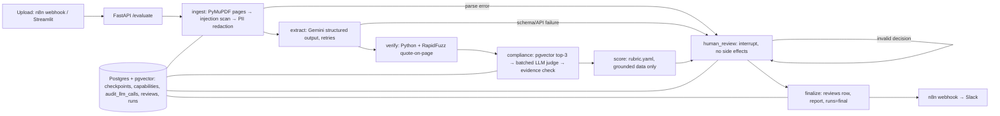

# RFP Intelligence Platform

A governed, human-in-the-loop, multi-agent system that ingests an RFP, extracts requirements with citations, verifies every claim against the source, checks compliance against company capabilities, computes a deterministic score, and fails closed: nothing is final until a human approves or overrides with a written reason.

> Status: Stages 1–3 implemented and verified locally (core engine; Postgres, compliance, evaluation; API, review console, n8n). Not production-ready — see Limitations.

## Demo

▶ **Demo video (2:25):**

| Review queue | Run detail: score, PDF page, verified quotes |
|---|---|
|  |  |

| Requirement quote + compliance evidence | Override blocked until a reason is written |
|---|---|
|  |  |

| Final decision, audited | Telemetry (tokens, latency, cost) |
|---|---|
|  |  |

| n8n intake workflow | n8n decision → Slack workflow |
|---|---|
|  |  |

## Stage 1 result on a real public RFP
`data/samples/mea_pbd_rfp.pdf`: MEA RFP for the Pravasi Bharatiya Divas website (40 pages, public).

| Metric | Value |
|---|---|
| Fields / requirements extracted | 4 / 14 |
| Citation pass rate | 1.0 (18/18 quotes found on cited page) |
| Redactions before LLM | 3 emails |
| Deadline / value (manually checked against p2) | 2026-02-02 / ₹70,00,000, both correct |
| Score | 38.8 → `no_go` (deadline already passed → timeline 0; compliance stubbed → neutral) |
| Extraction call | 14,691 in / 3,979 out tokens, 48.8 s, $0 (Gemini free tier) |

Single run, single document: this is a smoke test, not an accuracy measurement (Stage 2 builds the evaluation set).

## Architecture

LLMs extract and judge; Python verifies and scores. Every error, ungrounded claim or injection flag
ends at a human, never at a silent score.

## Quick start (whole flow)
```bash
cp .env.example .env            # set GOOGLE_API_KEY and LLM_MODEL; optionally SLACK_WEBHOOK_URL
docker compose up -d            # Postgres+pgvector and n8n (http://localhost:5678)
# 1) API (creates tables and embeds data/capabilities.md on first start)
N8N_WEBHOOK_URL=http://127.0.0.1:5678/webhook/rfp-reviewed PYTHONPATH=src \
  .venv/bin/uvicorn rfp.api.main:app --host 0.0.0.0 --port 8000
# 2) Review console (http://localhost:8501)
API_URL=http://127.0.0.1:8000 .venv/bin/streamlit run ui/app.py
```
Import `n8n/workflows/A_intake.json` and `B_review_sync.json` in n8n (Workflows → Import from file), then
publish both. They read `RFP_API_URL` and `SLACK_WEBHOOK_URL` from the n8n container environment
(`docker-compose.yml`). `SLACK_WEBHOOK_URL` defaults to a local mock — run `python n8n/mock_slack.py`
for a dry run with no external calls; set a real Slack Incoming Webhook URL to post to Slack.
Intake: `curl -F "file=@tender.pdf" http://localhost:5678/webhook/rfp-intake`.

`--host 0.0.0.0` is needed so the n8n container can reach the API on the host; the API has **no
authentication** — run it only on a trusted machine/network.

## Setup (Stage 1)
```bash
uv venv --python 3.13 .venv
uv pip install --python .venv/bin/python -r requirements.txt
cp .env.example .env   # then fill in LLM_MODEL and GOOGLE_API_KEY (never commit .env)
.venv/bin/pytest
```

## Stage 2 setup: Postgres + pgvector
```bash
docker compose up -d db                        # PostgreSQL 16 + pgvector
PYTHONPATH=src .venv/bin/python -m rfp.db      # create tables (idempotent)
PYTHONPATH=src .venv/bin/python -m rfp.capabilities   # embed data/capabilities.md (MOCK data)
```
Runs are checkpointed in Postgres: if the process dies while waiting for review, resume with
`PYTHONPATH=src .venv/bin/python -m rfp.run --thread-id <id>`. Set `RFP_STORAGE=local` to run
without a database (MemorySaver + JSONL telemetry).

## Run one RFP in the terminal (Stage 1)
```bash
PYTHONPATH=src .venv/bin/python -m rfp.run data/samples/synthetic_rfp.pdf --thread-id run-001
```
The pipeline parses, scans, redacts, extracts (Gemini), verifies citations and scores, then pauses
for human review. Enter a reviewer name and `approve`, or `override` with a final recommendation and a
required written reason. Per-call tokens, latency and cost are appended to `audit_llm_calls.jsonl`.

Pipeline: `ingest (parse → injection scan → PII redaction) → extract (LLM) → verify (Python) →
compliance (stub in Stage 1) → score (rubric.yaml) → human_review (interrupt) → finalize`.
Parse or extraction errors skip straight to human review and are never scored.

## Evaluation (Stage 2)
Three public Indian government/PSU RFPs, `gemini-2.5-flash` (free tier), one run each, 2026-10-15.
Reproduce: `PYTHONPATH=src:. .venv/bin/python -m eval.run_eval` (cached; `--refresh <name>` re-runs).

| RFP | Status | Req. recall | Req. precision | Labelled/Extracted | Deadline | Value | Citation pass | Rec. (expected) | LLM calls | Tokens in/out | Latency s | Cost $ | Time saved min | ROI ₹ (assumed) |
|---|---|---|---|---|---|---|---|---|---|---|---|---|---|---|
| mea_pbd | ok | 83% | 13% | 18/119 | yes | yes | 93% | no_go (n/a) | 2 | 38330/55146 | 219.4 | 0.0 | n/a | n/a |
| risl_ictms | ok | 93% | 10% | 14/132 | yes | n/a | 79% | no_go (n/a) | 2 | 99175/76619 | 305.3 | 0.0 | n/a | n/a |
| sbi_vcip | ok | 88% | 9% | 17/163 | yes | n/a | 81% | no_go (n/a) | 3 | 95931/119968 | 679.3 | 0.0 | n/a | n/a |

How to read this honestly:
- **Labels are DRAFTS written by the assistant from the source text**, not yet human-verified
  (`data/eval/labels/*.json`, `label_status`). Numbers are provisional until a human checks them.
- **Recall 83–93%**: most bid-level requirements are found. **Precision 9–13%** is low because the model
  lists 119–163 fine-grained items against 14–18 bid-level labels; with `gemini-3.8-flash` the same
  MEA RFP gave 14 items. Over-extraction also drives latency (3.7–11.3 min/RFP) and output size —
  SBI's extraction used 65,520 of 65,536 output tokens, i.e. it nearly truncated.
- Matching: content-word WRatio ≥ 80 and numbers must agree (see `eval/metrics.py` for why not plain ratio).
- **Deadline 3/3 correct; value correct on MEA and correctly omitted where no value is stated.**
- Cost is $0 (free tier). Score agreement, time saved and ROI are **n/a**: they need a human's own
  recommendation and a timed manual read (`expected_recommendation`, `manual_minutes`), which are
  deliberately not invented. ROI assumptions (₹1,500/h, ₹84/USD, 15 min review) are inputs, not facts.

## Limitations
| Risk | Mitigation | Residual limitation |
|---|---|---|
| Prompt injection in RFP text | Heuristic regex scan on normalized text; flagged runs capped at "review" and shown to a human | Heuristic only: paraphrased or novel attacks bypass it; some benign phrases are flagged |
| PII leakage to LLM | Regex redaction (email, PAN, phone, checksum-validated Aadhaar) per page before any LLM call | No names/addresses yet (NER in Stage 2); 10-digit amounts may be redacted as phones; redaction ≠ anonymization |
| Hallucinated claims | Every quote verified on its cited page (normalized exact/fuzzy ≥95, numbers must match exactly); ungrounded claims excluded from scoring | Proves the quote exists, not that it supports the claim; reformatted numbers are marked ungrounded |
| Model non-determinism | Temperature 0; deterministic scorer | Same PDF can be categorised differently across runs (observed: a liquidated-damages clause labelled `commercial` in one run, `legal_risk` in the next) |
| Compliance claims | Top-3 pgvector retrieval per requirement; LLM judges using only those passages; Python verifies evidence quotes; unverifiable verdicts scored neutral | Top-3 retrieval can miss the relevant section (observed: headcount not retrieved for a combined experience+headcount requirement → `partial`); `capabilities.md` is mock data |
| Free-tier LLM quota | Batched compliance judge (1 call/RFP), daily-quota errors not retried, embedding batching | 20 generate requests/day/model; extraction granularity varies by model (14 vs 119 requirements on the same RFP) |
| API / UI exposure | Server-chosen upload names, PDF magic-byte + size checks, override reason enforced at API and in graph, escaped HTML report with CSP | **No authentication/authorization**, no TLS, no rate limiting; `/evaluate` is synchronous (minutes on free tier) |
| Scanned/image PDFs | Detected and routed to the error state | No OCR in this version |
